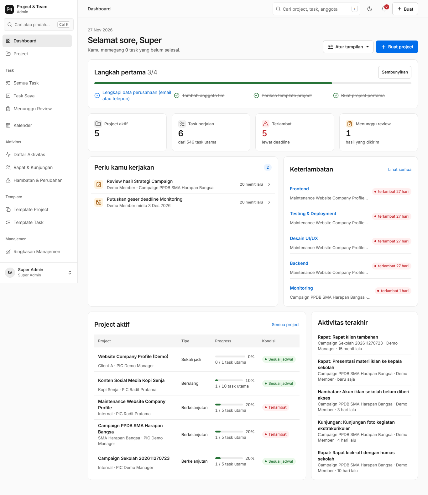
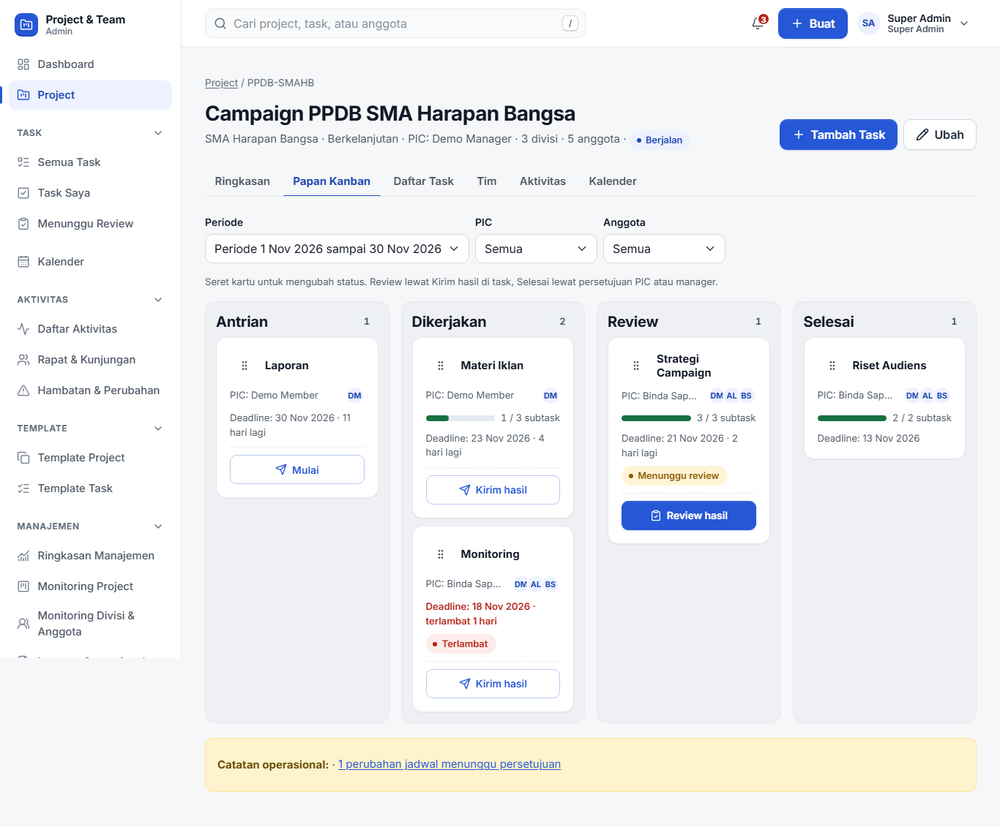

# Project & Team Management

Versi 2.0 (November 2026). Sistem manajemen project dan tim untuk agensi (developer, content creator, digital marketing): **dua aplikasi Laravel 13** yang memakai satu database MySQL yang sama.

- **Admin App** (`admin-app`, untuk desktop): data master, project dari template, Kanban, review hasil, monitoring, laporan, hak akses, dan menu dinamis.
- **Team App** (`team-app`, untuk HP): task saya, papan, checklist, kirim hasil, kalender, aktivitas, dan profil.

| Admin: ringkasan | Admin: Kanban project | Tim di HP: beranda |
|---|---|---|
|  |  |  |

## Isi

1. [Yang baru di versi 2.0](#yang-baru-di-versi-20)
2. [Coba di komputer sendiri (sekitar 5 menit)](#coba-di-komputer-sendiri-sekitar-5-menit)
3. [Pasang di server sendiri (Linux)](#pasang-di-server-sendiri-linux)
4. [Memperbarui instalasi versi sebelumnya](#memperbarui-instalasi-versi-sebelumnya)
5. [Kalau ada masalah](#kalau-ada-masalah)
6. [Fitur per peran](#fitur-per-peran)
7. [Versi online](#versi-online)
8. [Teknologi, struktur folder, dan uji](#teknologi)

## Yang baru di versi 2.0

**Tampilan baru** untuk kedua app, mengikuti pola aplikasi kerja modern (Vercel, Supabase, Railway):
- Warna netral, garis tipis tanpa bayangan, dan biru hanya untuk aksi utama. Status selalu berupa titik dan teks, tidak hanya warna.
- **Mode gelap** penuh. Tombol terang/gelap ada di bilah atas, pilihan "ikuti sistem" ada di menu akun.
- Sidebar berkelompok dengan pencarian `Ctrl K`. Bilah atas berisi breadcrumb, tombol **Buat**, dan lonceng. Halaman project memakai tab yang tetap terlihat saat digulir.
- Tetap rapi saat data sangat banyak. Tabel tidak bergeser ke samping di layar 1280 sampai 1920 px, kepala tabel tetap di atas, dan kakinya menulis "1-25 dari 1.234". Kolom Kanban bergulir sendiri dan menampilkan 50 kartu dulu (**Tampilkan 50 lagi**). Diuji dengan 3 perusahaan, 420 project, dan 32.373 task.
- Huruf Inter (sesuai tabel 6.1 petunjuk teknis) dan Geist Mono untuk kode, keduanya berlisensi OFL dan disajikan dari server sendiri. Semua ikon ada dalam satu berkas. Halaman tidak lebih lambat dari desain lama: jumlah query per halaman sama ([`docs/evidence/performance.md`](docs/evidence/performance.md)).

**Fitur tambahan dari masukan pembina (26 November 2026):**
- **Client per company.** Di Data Master, Client, centang company yang melayani client itu (tabel baru `client_company`). Saat membuat project, pilihan Client otomatis tersaring sesuai Company yang dipilih. Client tanpa centang berarti client umum yang boleh dipakai semua company. Server juga menolak client yang bukan milik company project.
- **Hasil task boleh kosong.** Pilihan per project (tabel baru `project_settings`) untuk pekerjaan yang tidak punya hasil untuk dilaporkan, misalnya maintenance atau riset. Task di project itu bisa dikirim untuk review tanpa tautan atau berkas, termasuk lewat seret kartu atau dropdown status di Kanban.
- **Tautan tanpa `https://`.** Tautan hasil, publikasi, dan situs client boleh ditulis seperti `instagram.com/p/abc`. Aplikasi melengkapinya sendiri dan menolak tautan yang belum lengkap dengan contoh yang benar.
- **Lebih nyaman di HP.** Pencarian punya kotak cari sendiri. Panel Template tampil di atas formulir project. Kartu Kanban cukup satu baris: inisial PIC, checklist, deadline, dan dropdown status kecil. Memilih Review pada task yang wajib ada hasilnya langsung membuka formulir Kirim hasil. Tab project bisa digeser ke samping.

Dua tabel baru itu dibuat lewat migrasi `admin-app`. Tabel dari SQL modul tidak diubah, jadi aturan petunjuk teknis tetap berlaku.

## Coba di komputer sendiri (sekitar 5 menit)

Butuh **PHP 8.4** atau lebih baru (dengan ekstensi `pdo_mysql`, `mbstring`, `xml`, `curl`, `zip`, `gd`), **Composer 2**, **Node.js 22** atau lebih baru, dan **Docker Desktop** untuk MySQL. Dari folder ini jalankan:

```powershell
powershell -ExecutionPolicy Bypass -File setup.ps1    # Windows (Linux/macOS: ./setup.sh)
powershell -ExecutionPolicy Bypass -File start.ps1    # Linux/macOS: ./start.sh
```

`setup` melakukan ini:
- menyalakan MySQL dan memasang kedua app;
- membuat `.env` dan kunci aplikasi;
- membuat tabel (migrasi dan SQL modul);
- mengisi data awal, akun setiap peran, dan data contoh agensi (project berjalan, task berbagai status, template berisi task dan checklist).

Perintah ini aman dijalankan ulang. Tanpa Docker, isi `DB_*` di `admin-app/.env` lalu jalankan `setup.ps1 -NoDocker` (atau `./setup.sh --no-docker`).

Buka **Admin App** di http://127.0.0.1:8101 dan **Team App** di http://127.0.0.1:8102. Halaman masuk lokal punya tombol **Coba sebagai** untuk setiap akun berikut.

| Peran | Email | Sandi (lokal) | Masuk di |
|---|---|---|---|
| Super Admin | `admin@example.test` | `ptm-demo-2026` | Admin App |
| Manager | `demo.manager@example.test` | `ptm-demo-2026` | Admin App dan Team App |
| Member | `demo.member@example.test` | `ptm-demo-2026` | Team App (juga Admin App dengan menu terbatas) |
| Tim contoh | `radit@example.test` (manager), `ayu@`, `binda@`, `putri@`, `dika@`, `raka@` (member) | `ptm-demo-2026` | sesuai peran |

Sandi demo itu hanya dipakai bila `.env` lokal mengosongkannya. Seeder menolak sandi ini di luar `APP_ENV=local`. Tombol Coba sebagai juga hanya muncul bila `APP_ENV=local` dan `PTM_DEMO_LOGIN=true`.

## Pasang di server sendiri (Linux)

Langkah ini untuk server kantor atau VPS. Contohnya memakai Ubuntu 24.04 LTS, Nginx, PHP 8.4-FPM, dan MySQL 8. Kedua app dipasang di satu server, sesuai petunjuk teknis, dengan satu (sub)domain per app:

| App | Contoh alamat | Folder web (root) |
|---|---|---|
| Admin App | `admin.example.com` | `/var/www/project-team-management/admin-app/public` |
| Team App | `team.example.com` | `/var/www/project-team-management/team-app/public` |

Ganti `example.com` dengan domain sendiri (misalnya `admin.kantor.co.id`), lalu arahkan rekaman DNS A kedua subdomain ke IP server. Berkas siap salin ada di `docs/server/`: [`nginx-ptm.conf`](docs/server/nginx-ptm.conf), [`php-ptm.ini`](docs/server/php-ptm.ini), dan [`apache-ptm.conf`](docs/server/apache-ptm.conf) bila server memakai Apache.

Langkah 3 sampai 9 sudah diuji di server Linux tiruan (container Nginx 1.27, PHP 8.4-FPM, dan MySQL 8.4) dari zip ini. Hasilnya ada di [`docs/evidence/tests/server-install.txt`](docs/evidence/tests/server-install.txt). Langkah 1 (paket `apt`) dan 10 (HTTPS) tidak bisa diuji di sana. Keduanya memakai perintah standar Ubuntu dan Certbot.

### 1. Pasang paket

Aplikasi ini butuh **PHP 8.4**. Pustakanya (Symfony 8.1) menolak PHP 8.3, padahal Ubuntu 24.04 bawaannya memasang PHP 8.3. Karena itu PHP 8.4 diambil dari PPA `ondrej/php`:

```bash
sudo apt update
sudo apt install -y software-properties-common curl git unzip nginx mysql-server
sudo add-apt-repository -y ppa:ondrej/php
sudo apt update
sudo apt install -y php8.4-fpm php8.4-cli php8.4-mysql php8.4-mbstring php8.4-xml php8.4-curl php8.4-zip php8.4-gd
php -v        # harus 8.4.x
```

Pasang **Composer 2** mengikuti https://getcomposer.org/download/ (jangan memakai paket `composer` dari apt, karena paket itu menarik PHP 8.3), lalu pindahkan ke `/usr/local/bin/composer`.

**Node.js 22** hanya dibutuhkan untuk membangun CSS dan JS (langkah 4). Ada dua pilihan:
- pasang Node.js 22 di server (https://nodejs.org/en/download);
- jalankan `npm ci && npm run build` di laptop, lalu salin folder `admin-app/public/build` dan `team-app/public/build` ke server.

Server lain juga bisa dipakai, asalkan memakai PHP 8.4 dengan ekstensi di atas dan MySQL 8.0 atau lebih baru. Yang sudah diuji: MySQL 8.4 dan TiDB (kompatibel MySQL 8.0). MariaDB belum diuji.

### 2. Taruh aplikasi di server

```bash
sudo mkdir -p /var/www
sudo unzip project-team-management-v2.0.zip -d /var/www      # menghasilkan /var/www/project-team-management
sudo chown -R $USER:www-data /var/www/project-team-management
cd /var/www/project-team-management
```

### 3. Buat database

```bash
sudo mysql
```
```sql
CREATE DATABASE project_team_management CHARACTER SET utf8mb4 COLLATE utf8mb4_unicode_ci;
CREATE USER 'ptm'@'localhost' IDENTIFIED BY 'ganti-dengan-sandi-kuat';
GRANT ALL PRIVILEGES ON project_team_management.* TO 'ptm'@'localhost';
FLUSH PRIVILEGES;
EXIT;
```

### 4. Pasang pustaka dan bangun tampilan (kedua app)

```bash
for app in admin-app team-app; do
  (cd $app && composer install --no-dev --optimize-autoloader && npm ci && npm run build)
done
```

`npm run build` mengunduh huruf Inter dan Geist Mono satu kali, jadi butuh internet. Setelah itu huruf disajikan dari server sendiri.

### 5. Isi `.env` Admin App

```bash
cd /var/www/project-team-management/admin-app
cp .env.example .env
nano .env
```

Ubah baris berikut. Baris lain biarkan seperti contoh.

| Variabel | Isi |
|---|---|
| `APP_ENV` | `production` |
| `APP_DEBUG` | `false` |
| `APP_URL` | `https://admin.example.com` |
| `ADMIN_APP_URL` | `https://admin.example.com` (tambahkan barisnya) |
| `TEAM_APP_URL` | `https://team.example.com` |
| `DB_HOST`, `DB_PORT` | `127.0.0.1`, `3306` |
| `DB_DATABASE`, `DB_USERNAME`, `DB_PASSWORD` | `project_team_management`, `ptm`, sandi dari langkah 3 |
| `LOG_LEVEL` | `warning` |
| `INITIAL_ADMIN_EMAIL` | email Super Admin pertama, misalnya `admin@kantor.co.id` |
| `INITIAL_ADMIN_PASSWORD` | sandi Super Admin pertama, minimal 12 karakter |
| `SESSION_SECURE_COOKIE` | `true` setelah HTTPS aktif (langkah 10). Tambahkan barisnya, dan biarkan kosong selama masih http |

`DEBUGBAR_ENABLED=false` dan `PTM_DEMO_LOGIN=false` sudah benar dari contoh. `APP_KEY` dibuat otomatis di langkah berikut.

### 6. Buat tabel dan data awal

```bash
php artisan ptm:setup
```

Perintah ini melakukan, berurutan:
1. membuat `APP_KEY`;
2. menjalankan migrasi Laravel;
3. mengimpor `docs/project_team_management_laravel.sql` **satu kali** (dilewati bila tabel modul sudah ada);
4. mengisi data awal: peran, hak akses, menu, pengaturan, dan akun Super Admin dari `INITIAL_ADMIN_*`.

Di `production` tidak ada akun demo dan tidak ada data contoh. Perintah ini aman diulang.

Kalau petunjuk teknis mengharuskan impor lewat phpMyAdmin, jalankan langkah manualnya:
1. `php artisan key:generate`;
2. `php artisan migrate --force`;
3. impor berkas SQL itu sekali lewat phpMyAdmin (menu Import), atau `mysql -u ptm -p project_team_management < ../docs/project_team_management_laravel.sql`;
4. `php artisan db:seed --force`.

### 7. Isi `.env` Team App

```bash
cd /var/www/project-team-management/team-app
cp .env.example .env
nano .env          # APP_ENV=production, APP_DEBUG=false, APP_URL=https://team.example.com,
                   # ADMIN_APP_URL=https://admin.example.com, TEAM_APP_URL=https://team.example.com, LOG_LEVEL=warning
php artisan ptm:setup
```

`ptm:setup` di Team App membuat `APP_KEY` sendiri (harus berbeda dari Admin App) dan menyalin sambungan database dari `../admin-app/.env`. Team App tidak membuat tabel: `migrate` dan `db:seed` sengaja ditolak di sana.

Lampiran hasil task dan foto profil dari kedua app disimpan di satu folder, `admin-app/storage/app/private`, jadi berkas yang diunggah di Team App terbuka di Admin App. Bila kedua app dipasang di folder atau server berbeda, isi `PTM_STORAGE_ROOT` di kedua `.env` dengan folder bersama yang sama.

### 8. Izin folder, batas unggah, dan cache

```bash
cd /var/www/project-team-management
for app in admin-app team-app; do
  (cd $app && php artisan optimize)
  sudo chown -R www-data:www-data $app/storage $app/bootstrap/cache
  sudo chmod -R ug+rwX $app/storage $app/bootstrap/cache
done
sudo cp docs/server/php-ptm.ini /etc/php/8.4/fpm/conf.d/99-ptm.ini
sudo systemctl restart php8.4-fpm
```

- **Izin folder.** PHP berjalan sebagai `www-data` dan harus bisa menulis `storage` dan `bootstrap/cache` di kedua app. Team App menulis lampiran ke `admin-app/storage`, jadi izin di folder itu wajib.
- **Batas unggah.** `php-ptm.ini` menaikkan batas unggah PHP dari bawaan 2 MB, karena lampiran hasil task boleh sampai 10 MB.
- **Cache.** `php artisan optimize` menyimpan konfigurasi, route, dan tampilan supaya cepat. Setiap kali `.env` diubah, jalankan lagi `php artisan optimize` di app itu.

### 9. Nginx

```bash
sudo cp docs/server/nginx-ptm.conf /etc/nginx/sites-available/ptm.conf
sudo nano /etc/nginx/sites-available/ptm.conf      # ganti admin.example.com dan team.example.com
sudo ln -s /etc/nginx/sites-available/ptm.conf /etc/nginx/sites-enabled/ptm.conf
sudo nginx -t && sudo systemctl reload nginx
```

Buka `http://admin.example.com/login` lalu masuk dengan `INITIAL_ADMIN_EMAIL` dan `INITIAL_ADMIN_PASSWORD`. `http://team.example.com/login` harus terbuka juga.

### 10. HTTPS

```bash
sudo apt install -y certbot python3-certbot-nginx
sudo certbot --nginx -d admin.example.com -d team.example.com
```

Setelah itu, di kedua `.env`:
1. pastikan semua alamat memakai `https://`;
2. tambahkan `SESSION_SECURE_COOKIE=true`;
3. jalankan lagi `php artisan optimize` di kedua app.

### 11. Langkah pertama di aplikasi

Masuk sebagai Super Admin di Admin App. Dashboard menampilkan **Langkah pertama**:
1. lengkapi data perusahaan;
2. tambah anggota tim (divisi dan jabatan baru bisa dibuat langsung dari formulir anggota);
3. periksa template project;
4. buat project pertama.

Client ditambah di Data Master, Client, sekalian mencentang company yang melayaninya. Manager dan member masuk di Admin App atau Team App sesuai perannya.

**Server uji dengan data contoh (opsional, jangan di server produksi).** Pakai `APP_ENV=staging` dan isi `DEMO_SEED_PASSWORD` (minimal 12 karakter) di `admin-app/.env`, lalu jalankan:

```bash
php artisan db:seed --class=UatScenarioSeeder --force
```

Hasilnya tim agensi sintetis:
- manager `radit@example.test`;
- member `ayu`, `binda`, `putri`, `dika`, dan `raka` (semua `@example.test`), dengan sandi `DEMO_SEED_PASSWORD`;
- client SMA Harapan Bangsa dan Kopi Senja;
- project berulang, project berkelanjutan, dan arsip 520 task.

### Cadangan

- **Database:** `mysqldump -u ptm -p --single-transaction project_team_management > ptm-$(date +%F).sql`. Jadwalkan lewat cron, misalnya setiap malam.
- **Berkas:** salin folder `admin-app/storage/app/private` (lampiran dan foto profil).
- Simpan juga kedua berkas `.env`. Tanpa `APP_KEY` yang sama, sesi dan data terenkripsi tidak bisa dibaca.

Aplikasi ini tidak memakai antrean (queue), jadwal (cron Laravel), atau email, jadi tidak perlu worker atau cron untuk menjalankannya.

## Memperbarui instalasi versi sebelumnya

Database versi sebelumnya bisa dipakai langsung, tanpa impor ulang:

```bash
# cadangkan database dan kedua .env dulu (lihat Cadangan)
# timpa folder aplikasi dengan isi zip baru, tetapi pertahankan admin-app/.env, team-app/.env, dan admin-app/storage
cd /var/www/project-team-management
for app in admin-app team-app; do
  (cd $app && composer install --no-dev --optimize-autoloader && npm ci && npm run build)
done
(cd admin-app && php artisan migrate --force)                 # hanya di admin-app: tabel client_company dan project_settings
for app in admin-app team-app; do (cd $app && php artisan optimize); done
sudo chown -R www-data:www-data admin-app/storage admin-app/bootstrap/cache team-app/storage team-app/bootstrap/cache
sudo systemctl restart php8.4-fpm
```

Setelah diperbarui, semua client lama menjadi client umum (boleh dipakai semua company) sampai company-nya dicentang di Data Master, Client. Semua project lama tetap mewajibkan hasil, sampai pilihan "Hasil task boleh kosong" dinyalakan di formulir project.

Jangan menjalankan `migrate:fresh`, `db:wipe`, atau impor SQL ulang pada database yang sudah berisi data. Perintah perusak itu juga diblokir di kode.

## Kalau ada masalah

| Gejala | Penyebab dan jalan keluar |
|---|---|
| `composer install` menulis "requires php >=8.4.1" | PHP di server masih 8.3. Pasang PHP 8.4 (langkah 1), lalu cek `php -v` dan `composer -V` memakai PHP yang sama. |
| `composer install` menulis "ext-gd" atau "ext-zip is missing" | Pasang `php8.4-gd` dan `php8.4-zip`. |
| Halaman 500 dan `storage/logs/laravel.log` menulis "Permission denied" | Ulangi `chown` dan `chmod` di langkah 8. Perintah `php artisan` yang dijalankan sebagai root bisa membuat berkas log milik root. |
| Halaman tanpa gaya (CSS hilang) atau "Vite manifest not found" | `npm run build` belum dijalankan di app itu, atau folder `public/build` belum ikut tersalin. |
| Kirim hasil berkas besar gagal, atau Nginx menjawab 413 | Batas unggah belum dipasang. Ulangi `php-ptm.ini` (langkah 8) dan cek `client_max_body_size 16m` di Nginx. |
| "419 Page Expired" setelah masuk | `APP_URL` tidak sama dengan alamat yang dibuka, atau `SESSION_SECURE_COOKIE=true` dipasang sebelum HTTPS aktif. Perbaiki `.env`, lalu `php artisan optimize`. |
| Perubahan `.env` tidak berpengaruh | Konfigurasi masih tersimpan di cache. Jalankan `php artisan optimize` lagi. |
| Lampiran dari Team App tidak terbuka di Admin App | Kedua app harus melihat folder yang sama. Pasang di satu server sesuai langkah di atas, atau isi `PTM_STORAGE_ROOT` yang sama di kedua `.env`. |
| `php artisan migrate` di Team App ditolak | Memang disengaja. Migrasi hanya dijalankan di `admin-app`. |
| Anggota lupa sandi | Aplikasi tidak mengirim email, jadi tidak ada tautan atur ulang. Super Admin membuka Data Master, Anggota Tim, lalu Ubah, dan mengisi **Kata sandi baru**. |

## Fitur per peran

| Peran | Yang bisa dilakukan |
|---|---|
| **Super Admin** | Semua akses: perusahaan, divisi, jabatan, anggota, client (dan company yang melayaninya), template, pengaturan sistem, role dan hak akses, menu dinamis, dan log aktivitas semua aksi. |
| **Manager** | Membuat project (sekali, berulang, atau berkelanjutan) dari template dengan pratinjau task, memilih tim dari divisi, dan menentukan apakah hasil task boleh kosong. Mengelola Kanban dengan aturan status di server, PIC dan banyak pelaksana per task, serta checklist. Meninjau hasil (terima, atau revisi dengan alasan wajib) dan menyetujui pengajuan geser deadline (target awal tetap tercatat). Membuka periode baru tanpa menutup project induk, melihat laporan, dan memantau project. Semua ini hanya untuk perusahaan tempat ia menjadi anggota aktif. |
| **Member** | Membuka Task saya, mencentang checklist, mengirim hasil (tautan, berkas, atau kosong bila project mengizinkan), dan mengirim ulang setelah revisi. Mencatat aktivitas dan hambatan, mengajukan geser deadline, dan memakai kalender. Hanya untuk project yang ia ikuti; halaman manajemen dijawab 403. |

Yang memudahkan pemakaian sehari-hari (penilaian pembina 14 November 2026 dan rencana [`docs/UX-PLAN.md`](docs/UX-PLAN.md)):
- **Perlu kamu kerjakan** di Dashboard: hasil yang menunggu review, pengajuan deadline, task yang dikembalikan, dan task terlambat. Setiap butir langsung menuju tempat tindakannya.
- **Detail task di panel samping** (penuh layar di HP). Panel ini bisa dibuka dari Kanban, daftar task, lonceng, dan kalender. Dari panel bisa mencentang checklist, mengirim hasil, menerima atau meminta revisi, dan memutuskan deadline. Papan di belakangnya tetap dan langsung diperbarui.
- **Tanpa bolak-balik halaman.** Kode company dan client dibuat otomatis. Ada tombol Client baru dan Company baru di formulir project, Tambah task dalam satu layar, tombol **Pakai** template, dan pilihan cepat tanggal.
- **Aksi massal dan perintah cepat.** Bisa Mulai kerjakan, Ganti PIC, atau Tambah pelaksana untuk beberapa task sekaligus. `Ctrl K` membuka palet perintah, `?` menampilkan pintasan, dan `n` membuat task baru.
- **Template mengikuti cara kerja nyata.** Template berulang memakai tanggal ("tgl 28"). Task bisa rutin Setiap hari atau Setiap hari kerja dengan jam. Ada **Ulangi** untuk membuat Konten 1 sampai 5 dan **Tempel daftar** untuk mengubah daftar fitur menjadi task. Periode baru meneruskan PIC dan pelaksana.
- **Pengaturan tanpa istilah teknis.** Urutan menu diatur dengan seret-lepas, dan hak akses berupa tabel centang.

Aturan yang dijaga di server, bukan hanya di tampilan:
- Task masuk **Review** hanya lewat kirim hasil (atau langsung, bila project mengizinkan hasil kosong), dan masuk **Selesai** hanya lewat terima oleh peninjau. Kartu yang diseret ke kolom terlarang dikembalikan.
- Deadline tidak bisa ditimpa langsung. Perubahannya lewat `schedule_change_requests` yang disetujui manager, dan target awal tetap tercatat.
- Data tanpa `deleted_at` (divisi, jabatan, anggota, keanggotaan) dinonaktifkan, tidak dihapus.
- **Satu aturan cakupan data** (`App\Services\Scope`) untuk daftar, filter, data master, detail, dan Kanban di kedua app. Super Admin melihat semua, Manager melihat company tempat ia anggota aktif, dan Member melihat project yang ia ikuti. URL langsung ke data di luar cakupan dijawab 403.
- **Log aktivitas** mencatat setiap aksi yang mengubah data di kedua app, tanpa kata sandi.
- DataTables memuat data dari server (cari, urut, dan halaman di server).
- **Ukuran tampilan mengikuti tabel 6.1 petunjuk teknis.** Area klik minimal 44 x 44 px di HP dan 40 x 40 px di desktop. Ukuran ini diukur otomatis di setiap halaman (`docs/tools/ui-audit.mjs`).

## Versi online

Tiga tempat demo memakai desain versi 2.0. Masing-masing punya database sendiri (TiDB Cloud) dan dua app di Vercel:

| Tempat | Admin App | Team App | Isi |
|---|---|---|---|
| Instalasi baru | https://ptm-app-admin.vercel.app | https://ptm-app-team.vercel.app | hanya Super Admin, seperti server yang baru dipasang |
| Data contoh | https://ptm-demo-admin.vercel.app | https://ptm-demo-team.vercel.app | agensi dengan 15 orang, 22 project, dan sekitar 1.000 task |
| Skala besar | https://ptm-skala-admin.vercel.app | https://ptm-skala-team.vercel.app | 3 perusahaan, 420 project, dan 32.373 task |

Email dan sandi akun demo tidak ditulis di repositori publik. Keduanya ada di lembar akses yang dibagikan terpisah. Semua data di sana sintetis.

Di versi online, kedua app berjalan di dua container terpisah dengan penyimpanan sementara. Akibatnya, berkas yang diunggah bisa hilang saat container diganti. Kirim hasil berupa tautan saja di sana. Di server sendiri (langkah di atas) berkas tersimpan permanen. Cara versi online dibangun ada di `Dockerfile` dan folder `docker/` tiap app.

## Teknologi

Laravel 13 (PHP 8.4), MySQL 8 (lokal: Docker MySQL 8.4 dan phpMyAdmin), Bootstrap 5.3.8, jQuery 3.7.1, Yajra DataTables (datatables.net 2.3), SortableJS 1.15.7, FullCalendar 6.1.22, ikon Lucide (ISC), huruf Inter dan Geist Mono (OFL), dan Laravel Debugbar (hanya pengembangan). Versi pustaka dikunci, karena perintah pasang "terbaru" kini memasang versi mayor lain (catatan di `docs/RESEARCH.md`).

## Struktur

```
admin-app/      Laravel: manajemen (memegang migrasi schema)
team-app/       Laravel: aplikasi tim untuk HP (tanpa migrasi dan seeder; berkas disimpan di storage admin-app)
  Dockerfile, docker/   image tiap app untuk versi online
docs/
  project_team_management_laravel.sql   schema modul (diimpor satu kali)
  server/        contoh Nginx, Apache, dan setelan PHP untuk server sendiri
  RESEARCH.md    keputusan versi dan arsitektur
  UX-PLAN.md     rencana dan catatan perbaikan kegunaan
  tools/         skrip uji peramban, impor SQL, sinkron kode domain
  evidence/      hasil uji (tests/TESTING.md), audit UI, tangkapan layar, performa
  UAT.pdf        dokumen UAT
  video/         langkah rekaman video demo
docker-compose.yml   MySQL 8.4 + phpMyAdmin untuk komputer lokal
setup.ps1, setup.sh, start.ps1, start.sh   pasang dan jalankan di komputer lokal
```

Kode domain bersama (model, policy, service, aturan status) ditulis sekali di `admin-app`, lalu disalin ke `team-app` dengan `php docs/tools/sync-domain.php`. Tes `tests/Domain/SharedDomainTest` gagal bila salinannya berbeda.

## Uji

- Database uji: jalankan `sh docs/tools/prepare-test-db.sh`. Skrip ini membuat `ptm_test` dengan urutan pasang yang sama.
- Tes otomatis: jalankan `npm run build` dulu di kedua app (beberapa tes merender halaman yang memuat aset Vite), lalu `php artisan test` di masing-masing app. Hasil terakhir: admin 138 tes, tim 58 tes, semua lulus. Tes domain identik di kedua app.
- Uji peramban (kedua app berjalan):
  - `node docs/tools/smoke-test.mjs`: semua menu untuk 3 peran;
  - `node docs/tools/e2e-flow.mjs`: alur kerja dari project baru sampai periode baru;
  - `node docs/tools/ui-audit.mjs`: axe, area klik, ukuran tabel 6.1, jenis huruf, dan gulir samping.
- Hasil lengkap per skenario dan peran ada di `docs/evidence/tests/TESTING.md`. Dokumen UAT ada di `docs/UAT.pdf`.

README ini diuji dari nol (27 November 2026). Zip serah terima diekstrak ke folder baru lalu dipasang dua kali tanpa langkah tambahan. Penyesuaian karena server tiruan memakai container (nama host, socket PHP-FPM) ditulis di awal berkas buktinya:
- di server Linux tiruan mengikuti "Pasang di server sendiri" ([`docs/evidence/tests/server-install.txt`](docs/evidence/tests/server-install.txt));
- di Windows mengikuti "Coba di komputer sendiri", lalu bagian Uji ini dari folder itu ([`docs/evidence/tests/local-docker-install.txt`](docs/evidence/tests/local-docker-install.txt)).

Di kedua tempat, `/login` kedua app menjawab 200, dan tes dari folder Windows itu lulus semua.

## Catatan

Dibuat sebagai tugas PKL berdasarkan petunjuk teknis dan skema SQL dari tempat PKL. Dokumen petunjuk teknisnya tidak disertakan di repositori publik ini. Skema SQL disertakan karena dibutuhkan untuk memasang. Semua nama orang dan perusahaan di data contoh adalah sintetis.
