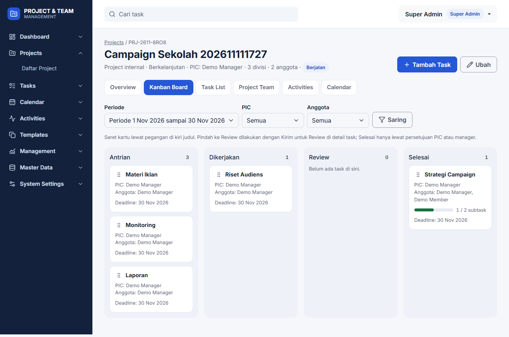
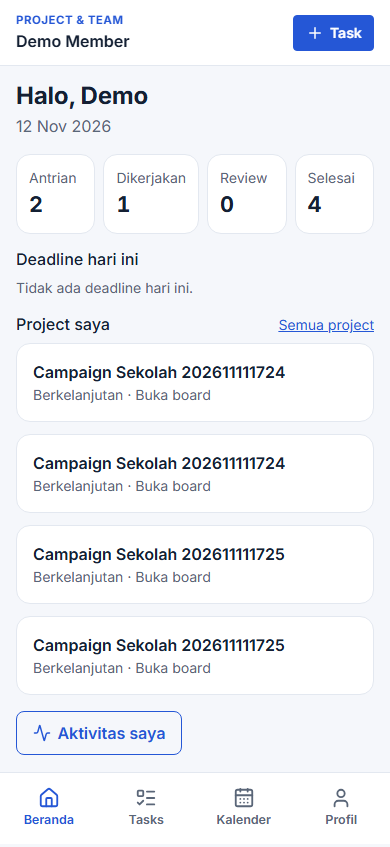

# Project & Team Management

Sistem manajemen project dan tim untuk agensi (developer, content creator, digital marketing): **dua aplikasi Laravel 13** yang berbagi satu database MySQL.

- **Admin App** (`admin-app`, desktop-first): master data, project dari template, Kanban, review hasil, monitoring, laporan, hak akses, dan menu dinamis.
- **Team App** (`team-app`, mobile-first): task saya, papan, checklist, kirim hasil, kalender, aktivitas, dan profil.

| Admin: ringkasan | Admin: Kanban project | Tim di HP: beranda |
|---|---|---|
|  |  |  |

Video alur kerja (rekaman aplikasi yang berjalan, bukan animasi): [`docs/video/ptm-demo.mp4`](docs/video/ptm-demo.mp4).

## Fitur per peran

| Peran | Yang bisa dilakukan |
|---|---|
| **Super Admin** | Semua akses: perusahaan, divisi, jabatan, anggota, client, template, pengaturan sistem, role dan permission, menu dinamis. |
| **Manager** | Membuat project (sekali, berulang, berkelanjutan) dari template dengan pratinjau task; memilih tim dari divisi; Kanban dengan aturan status di server; PIC dan banyak pelaksana per task; checklist; meninjau hasil (terima atau revisi wajib beralasan); menyetujui pengajuan geser deadline (target awal tetap tercatat); membuka periode baru tanpa menutup project induk; laporan dan monitoring. Hanya untuk perusahaan tempat ia anggota aktif. |
| **Member** | Task saya, centang checklist, kirim hasil (tautan atau berkas), kirim ulang setelah revisi, catat aktivitas dan hambatan, ajukan geser deadline, kalender. Hanya untuk project yang ia ikuti; halaman manajemen dijawab 403. |

Aturan penting yang dijaga di server, bukan hanya di tampilan:
- Task ke **Review** hanya lewat kirim hasil; ke **Selesai** hanya lewat terima oleh peninjau. Kartu yang diseret ke kolom terlarang dikembalikan.
- Deadline tidak bisa ditimpa langsung: lewat `schedule_change_requests` yang disetujui manager; baseline tetap.
- Data tanpa `deleted_at` (divisi, jabatan, anggota, keanggotaan) dinonaktifkan, tidak dihapus. Perintah perusak database (`migrate:fresh`, `db:wipe`) diblokir di kode.
- DataTables memuat data dari server (25 baris per halaman, cari dan urut di server); diuji dengan 520 task.

## Teknologi

Laravel 13 (PHP 8.3+), MySQL 8.4 (Docker) + phpMyAdmin, Bootstrap 5.3.8, jQuery 3.7.1, Yajra DataTables (datatables.net 2.3), SortableJS 1.15.7, FullCalendar 6.1.22, ikon Lucide (ISC), Laravel Debugbar (hanya pengembangan). Versi pustaka dikunci karena perintah pasang "terbaru" kini memasang versi mayor lain (catatan di `docs/RISET.md`).

## Memasang dari nol

Persyaratan: PHP 8.3 atau lebih baru dengan ekstensi `pdo_mysql`, `mbstring`, `openssl`, `intl`, `fileinfo`; Composer 2; Node.js 22+ dan npm; Docker Desktop (atau Docker Engine) untuk MySQL.

```bash
git clone https://github.com/Tristan-tech-ai/project-team-management.git
cd project-team-management
```

1. **Database.** Buat berkas `.env` di folder akar berisi dua sandi kuat (berkas ini tidak di-commit):
   ```
   MYSQL_ROOT_PASSWORD=isi-sandi-kuat-root
   MYSQL_PASSWORD=isi-sandi-kuat-aplikasi
   ```
   lalu `docker compose up -d`. MySQL ada di `127.0.0.1:33061` (database `project_team_management`, user `ptm`), phpMyAdmin di `http://127.0.0.1:8180`.
2. **Dua aplikasi.** Untuk `admin-app` dan `team-app` masing-masing:
   ```bash
   composer install
   npm install
   cp .env.example .env        # Windows PowerShell: copy .env.example .env
   php artisan key:generate    # APP_KEY kedua app harus berbeda
   ```
   Isi `DB_PASSWORD` di kedua `.env` sama dengan `MYSQL_PASSWORD`.
3. **Skema.** Hanya di `admin-app`: `php artisan migrate`. Lalu impor `docs/project_team_management_laravel.sql` **satu kali** ke database `project_team_management` lewat phpMyAdmin (menu Import), atau `node docs/alat/impor-phpmyadmin.mjs` (menolak bila tabel modul sudah ada).
4. **Data awal.** Di `admin-app/.env` isi `INITIAL_ADMIN_EMAIL`, `INITIAL_ADMIN_PASSWORD` (minimal 12 karakter), dan untuk lokal `DEMO_SEED_PASSWORD`, lalu `php artisan db:seed` di `admin-app`.
5. **Jalankan.** `npm run build` di kedua app, lalu:
   ```bash
   cd admin-app && php artisan serve --port=8101   # http://127.0.0.1:8101
   cd team-app  && php artisan serve --port=8102   # http://127.0.0.1:8102
   ```
6. **Data contoh UAT (opsional, lokal saja, ditolak di production):** `php artisan db:seed --class=UatSkenarioSeeder` di `admin-app`. Isinya tim agensi sintetis: manager `radit@example.test`, member `ayu`, `binda`, `putri`, `dika`, `raka` (semua `@example.test`, sandi = `DEMO_SEED_PASSWORD` yang kamu isi), client SMA Harapan Bangsa dan Kopi Senja, project berulang, project berkelanjutan, dan arsip 520 task.

Masuk sebagai Super Admin dengan `INITIAL_ADMIN_EMAIL` di Admin App; manager dan member masuk di Admin App atau Team App sesuai perannya.

Jangan menjalankan `migrate:fresh`, `db:wipe`, atau impor SQL ulang pada database berisi data.

**Production:** `composer install --no-dev`, `APP_ENV=production`, `APP_DEBUG=false`, `DEBUGBAR_ENABLED=false`, lalu `npm run build`.

## Online (gratis)

Versi yang bisa dicoba langsung:

| Aplikasi | Alamat |
|---|---|
| Admin App | https://ptm-admin.vercel.app |
| Team App | https://ptm-team.vercel.app |

Akun masuk tidak diumumkan di sini; minta ke pemilik repositori.

Susunannya tetap sama dengan petunjuk teknis: satu database MySQL bersama untuk dua aplikasi yang dideploy terpisah, skema dari migrasi + SQL modul yang diimpor satu kali, nama tabel dan kolom tidak berubah. Kode aplikasi tidak diubah; yang ditambahkan hanya `Dockerfile`, `.dockerignore`, dan folder `docker/` di tiap app.

- **Database: TiDB Cloud Starter.** Kompatibel MySQL 8.0, gratis dalam kuota (5 GiB, 50 juta Request Unit per bulan), region AWS Singapura, koneksi wajib TLS. Sebelum online, seluruh tes dijalankan terhadap TiDB (12 November 2026): migrasi dan impor SQL lulus (40 tabel), tes admin 41/41 dan tim 31/31 lulus, uji semua menu untuk 3 peran (`docs/alat/asap.mjs`) tanpa galat, dan alur kerja ujung ke ujung (`docs/alat/e2e-alur.mjs`) 15/15 lulus. Rinciannya di [docs/bukti/uji/UJI.md](docs/bukti/uji/UJI.md#uji-versi-online-12-nov-2026).
- **Aplikasi: Vercel Container Runtime** (Beta, tersedia di paket gratis). Image dibangun dari `Dockerfile` tiap app: aset Vite, PHP 8.4 dengan FrankenPHP, `composer install --no-dev` (Debugbar tidak ikut terpasang), `APP_ENV=production`, `APP_DEBUG=false`, `DEBUGBAR_ENABLED=false`, log ke stderr, sesi dan cache di database.

Memasang sendiri:

1. **TiDB Cloud.** Buat instance Starter, buka Connect, buat sandi, lalu buat database `project_team_management` (misalnya `CREATE DATABASE project_team_management;` di SQL Editor).
2. **Skema dan data awal**, dari `admin-app` lokal dengan env menunjuk ke TiDB (`DB_HOST`, `DB_PORT=4000`, `DB_USERNAME`, `DB_PASSWORD`, `DB_DATABASE`, dan `MYSQL_ATTR_SSL_CA` berisi path berkas CA sistem, misalnya `/etc/ssl/certs/ca-certificates.crt`):
   ```bash
   php artisan migrate --force
   php ../docs/alat/impor-sql.php ../docs/project_team_management_laravel.sql   # satu kali; dilewati bila tabel modul sudah ada
   php artisan db:seed                                                       # INITIAL_ADMIN_* dan DEMO_SEED_PASSWORD
   ```
   phpMyAdmin yang diarahkan ke TiDB juga bisa dipakai untuk impor, asalkan memakai TLS.
3. **Vercel**, sekali untuk tiap app: Add New Project, impor repositori ini, Root Directory `admin-app` (atau `team-app`), Framework Preset **Container**, region Functions `sin1` (dekat TiDB Singapura). Isi Environment Variables:

   | Variabel | Isi |
   |---|---|
   | `APP_KEY` | kunci baru per app (`php artisan key:generate --show`), tipe Sensitive |
   | `DB_HOST`, `DB_USERNAME`, `DB_PASSWORD` | dari TiDB Connect, tipe Sensitive |
   | `DB_CONNECTION`, `DB_PORT`, `DB_DATABASE` | `mysql`, `4000`, `project_team_management` |
   | `APP_URL` | alamat app itu sendiri |
   | `ADMIN_APP_URL`, `TEAM_APP_URL` | alamat kedua app (tautan antar-app) |
   | `APP_NAME`, `SESSION_COOKIE`, `CACHE_PREFIX` | beda per app, seperti `.env.example` |
   | `FORCE_HTTPS`, `SESSION_SECURE_COOKIE` | `on`, `true` (Vercel melayani lewat HTTPS) |
   | `APP_LOCALE`, `APP_FALLBACK_LOCALE` | `id`, `en` |

   Lalu Deploy. Setiap push ke `main` membangun ulang kedua app.

Batasan versi online:
- Berkas yang diunggah (foto profil, lampiran hasil task) disimpan di penyimpanan sementara container: hilang saat instance diganti dan tidak dibagi antar-app. Tautan hasil kerja tetap aman karena tersimpan di database. Untuk berkas permanen dibutuhkan penyimpanan objek (misalnya disk `s3` Laravel), yang berarti menambah paket.
- App tidur setelah 5 menit tanpa kunjungan; permintaan pertama sesudahnya sedikit lebih lambat.
- Image di atas dibangun dan dijalankan oleh Vercel. Untuk menjalankannya dengan Docker di komputer sendiri: `docker build -t ptm-admin admin-app`, lalu `docker run -p 8101:80` dengan variabel yang sama (untuk MySQL lokal tanpa TLS, isi `MYSQL_ATTR_SSL_CA` dengan string kosong).

## Struktur

```
admin-app/      Laravel: manajemen (memegang migrasi schema)
team-app/       Laravel: aplikasi tim mobile-first (tanpa migrasi)
  Dockerfile, docker/   image produksi tiap app (Docker dan Vercel)
docs/
  project_team_management_laravel.sql   schema modul (diimpor satu kali)
  RISET.md      keputusan versi dan arsitektur
  alat/         skrip uji peramban, impor (phpMyAdmin atau impor-sql.php), sinkron kode domain
  bukti/        hasil uji (UJI.md), audit UI, tangkapan layar, performa
  UAT.pdf       dokumen UAT
  video/        video alur dan langkah rekamannya
docker-compose.yml   MySQL 8.4 + phpMyAdmin
```

Kode domain bersama (model, policy, service, aturan status) ditulis sekali di `admin-app` lalu disalin ke `team-app` dengan `php docs/alat/sinkron-domain.php`. Tes `tests/Domain/DomainSamaTest` gagal bila salinannya berbeda.

## Uji

- Database uji: `sh docs/alat/siapkan-db-uji.sh` (membuat `ptm_test` dengan urutan pasang yang sama).
- Tes: `npm run build` dulu di kedua app (beberapa tes merender halaman yang memuat aset Vite), lalu `php artisan test` di masing-masing app (admin 41, tim 31; tes domain identik di keduanya).
- Uji peramban (kedua app berjalan): `node docs/alat/asap.mjs` (semua menu untuk 3 peran) dan `node docs/alat/e2e-alur.mjs` (alur 17 langkah).
- Hasil lengkap per skenario dan peran: `docs/bukti/uji/UJI.md`; dokumen UAT: `docs/UAT.pdf`.

README ini diuji dari nol di folder dan database baru (12 November 2026) sampai login dan seluruh uji lulus, lalu diuji lagi dari klon repositori publik ini: tes admin 41/41 dan tim 31/31 lulus.

## Catatan

Dibuat sebagai tugas PKL berdasarkan petunjuk teknis dan skema SQL dari tempat PKL. Dokumen petunjuk teknisnya tidak disertakan di repositori publik ini; skema SQL disertakan karena dibutuhkan untuk memasang. Semua nama orang dan perusahaan di data contoh adalah sintetis.
