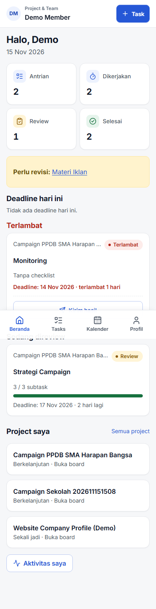

# Project & Team Management

Sistem manajemen project dan tim untuk agensi (developer, content creator, digital marketing): **dua aplikasi Laravel 13** yang berbagi satu database MySQL.

- **Admin App** (`admin-app`, desktop-first): master data, project dari template, Kanban, review hasil, monitoring, laporan, hak akses, dan menu dinamis.
- **Team App** (`team-app`, mobile-first): task saya, papan, checklist, kirim hasil, kalender, aktivitas, dan profil.

| Admin: ringkasan | Admin: Kanban project | Tim di HP: beranda |
|---|---|---|
|  |  |  |

Video alur kerja (rekaman aplikasi yang berjalan, bukan animasi): [`docs/video/ptm-demo.mp4`](docs/video/ptm-demo.mp4).

## Coba dalam 5 menit

Butuh PHP 8.3+, Composer 2, Node.js 22+, dan Docker Desktop (untuk MySQL). Dari folder ini:

```powershell
powershell -ExecutionPolicy Bypass -File setup.ps1    # Windows (Linux/macOS: ./setup.sh)
powershell -ExecutionPolicy Bypass -File start.ps1    # Linux/macOS: ./start.sh
```

`setup` menyalakan MySQL, memasang kedua app, membuat `.env` dan kunci aplikasi, membuat tabel (migrasi + SQL modul), lalu mengisi data awal, akun setiap peran, dan data contoh agensi (project berjalan, task berbagai status, template berisi task dan checklist). Aman dijalankan ulang. Tanpa Docker: `setup.ps1 -NoDocker` setelah mengisi `DB_*` di `admin-app/.env`.

Buka **Admin App** http://127.0.0.1:8101 dan **Team App** http://127.0.0.1:8102. Di halaman masuk lokal ada tombol **Coba sebagai** untuk setiap akun di bawah.

| Peran | Email | Sandi (lokal) | Masuk di |
|---|---|---|---|
| Super Admin | `admin@example.test` | `ptm-demo-2026` | Admin App |
| Manager | `demo.manager@example.test` | `ptm-demo-2026` | Admin App dan Team App |
| Member | `demo.member@example.test` | `ptm-demo-2026` | Team App (juga Admin App, menu terbatas) |
| Tim contoh | `radit@example.test` (manager), `ayu@`, `binda@`, `putri@`, `dika@`, `raka@` (member) | `ptm-demo-2026` | sesuai peran |

Sandi demo hanya dipakai bila `.env` lokal mengosongkannya; seeder menolak sandi ini di luar `APP_ENV=local`, dan tombol Coba sebagai hanya muncul bila `APP_ENV=local` dan `PTM_DEMO_LOGIN=true`.

## Fitur per peran

| Peran | Yang bisa dilakukan |
|---|---|
| **Super Admin** | Semua akses: perusahaan, divisi, jabatan, anggota, client, template, pengaturan sistem, role dan permission, menu dinamis, log aktivitas semua aksi. |
| **Manager** | Membuat project (sekali, berulang, berkelanjutan) dari template dengan pratinjau task; memilih tim dari divisi; Kanban dengan aturan status di server; PIC dan banyak pelaksana per task; checklist; meninjau hasil (terima atau revisi wajib beralasan); menyetujui pengajuan geser deadline (target awal tetap tercatat); membuka periode baru tanpa menutup project induk; laporan dan monitoring. Hanya untuk perusahaan tempat ia anggota aktif. |
| **Member** | Task saya, centang checklist, kirim hasil (tautan atau berkas), kirim ulang setelah revisi, catat aktivitas dan hambatan, ajukan geser deadline, kalender. Hanya untuk project yang ia ikuti; halaman manajemen dijawab 403. |

Kemudahan pakai (penilaian pembina 14 Nov 2026 dan rencana [`docs/UX-PLAN.md`](docs/UX-PLAN.md)):
- **Satu klik ke setiap halaman.** Menu dengan satu tujuan (Dashboard, Project, Kalender) langsung terbuka; kelompok lain tampil terbuka dengan ikon per menu, bisa dilipat dan diingat. Tombol **+ Buat** di kepala halaman dan pintasan `/` untuk mencari.
- **Perlu kamu kerjakan** di Dashboard: hasil yang menunggu review-mu, pengajuan geser deadline yang menunggu keputusanmu, task yang dikembalikan untuk revisi, task terlambat dan yang jatuh tempo dua hari ke depan, masing-masing langsung menuju tempat tindakannya.
- **Tanpa bolak-balik halaman.** Kode company dan client dibuat otomatis dari nama, data baru langsung aktif, tombol **Client baru** dan **Company baru** di formulir project, Tambah task dalam satu layar (project, judul, PIC, pelaksana, deadline), tombol **Pakai** di daftar template, filter papan langsung berlaku, kartu Kanban berisi langkah berikutnya (Mulai, Kirim hasil, Review hasil), pilihan cepat tanggal (Hari ini, Besok, Jumat, +1 minggu), dan tanggal yang langsung terbaca ("terlambat 2 hari").
- **Pengaturan tanpa istilah teknis.** Urutan menu diatur dengan seret-lepas dan pindah kelompok lewat satu pilihan; hak akses berupa tabel centang Lihat, Tambah, Ubah, Hapus, dan aksi khusus bernama biasa. Route dan kode izin tidak tampil di layar.
- **Diukur, bukan dikira.** `docs/tools/ux-metrics.mjs` menghitung klik, isian, dan halaman untuk 12 alur inti sebelum dan sesudah perubahan.

Aturan penting yang dijaga di server, bukan hanya di tampilan:
- Task ke **Review** hanya lewat kirim hasil; ke **Selesai** hanya lewat terima oleh peninjau. Kartu yang diseret ke kolom terlarang dikembalikan.
- Deadline tidak bisa ditimpa langsung: lewat `schedule_change_requests` yang disetujui manager; baseline tetap.
- Data tanpa `deleted_at` (divisi, jabatan, anggota, keanggotaan) dinonaktifkan, tidak dihapus. Perintah perusak database (`migrate:fresh`, `db:wipe`) diblokir di kode.
- DataTables memuat data dari server (baris per halaman dari Pengaturan Sistem, bawaan 25; cari dan urut di server); diuji dengan 520 task.
- **Satu aturan cakupan data** (`App\Services\Scope`) untuk daftar, filter (Company, Client, PIC, pelaksana, divisi), data master, detail, dan Kanban di kedua app: Super Admin semua, Manager company tempat ia anggota aktif, Member project yang ia ikuti. Data di luar cakupan tidak muncul di pilihan filter, dan URL langsung ke data itu dijawab 403.
- **Satu penyimpanan berkas untuk dua app.** Lampiran hasil task dan foto profil disimpan di storage `admin-app` (disk `shared`, folder `admin-app/storage/app/private`), termasuk yang diunggah lewat Team App, sehingga terbuka di kedua app. Bila kedua app dipasang di folder atau server berbeda, isi `PTM_STORAGE_ROOT` di kedua `.env` dengan folder bersama yang sama.
- **Log aktivitas**: setiap aksi yang mengubah data di kedua app tercatat (`audit_logs`) tanpa kata sandi; dilihat Super Admin di Pengaturan Sistem.
- **Pencarian global** di kepala Admin App: project, task, dan anggota dalam satu halaman, masing-masing dengan cakupan data yang sama seperti halaman aslinya (Member hanya menemukan rekan satu project, berdasarkan nama).
- **Timeline project** (Activities project): task selesai, rapat, kunjungan, revisi, hambatan, dan usulan perubahan deadline dalam satu urutan waktu, dengan kartu Kondisi Jadwal (target awal, target baru, status) seperti prototipe petunjuk teknis.
- **Ukuran tampilan mengikuti tabel 6.1 petunjuk teknis**: area klik minimal 44 x 44 px di HP dan 40 x 40 px di desktop, ukuran huruf, padding, dan kartu diukur otomatis di setiap halaman (`docs/tools/ui-audit.mjs`).

## Teknologi

Laravel 13 (PHP 8.3+), MySQL 8.4 (Docker) + phpMyAdmin, Bootstrap 5.3.8, jQuery 3.7.1, Yajra DataTables (datatables.net 2.3), SortableJS 1.15.7, FullCalendar 6.1.22, ikon Lucide (ISC), Laravel Debugbar (hanya pengembangan). Versi pustaka dikunci karena perintah pasang "terbaru" kini memasang versi mayor lain (catatan di `docs/RESEARCH.md`).

## Memasang dari nol (langkah manual)

Langkah di bawah sama dengan yang dijalankan `setup.ps1`/`setup.sh`, untuk yang ingin memasang satu per satu.

Persyaratan: PHP 8.3 atau lebih baru dengan ekstensi `pdo_mysql`, `mbstring`, `openssl`, `intl`, `fileinfo`; Composer 2; Node.js 22+ dan npm; Docker Desktop (atau Docker Engine) untuk MySQL.

```bash
git clone https://github.com/Tristan-tech-ai/project-team-management.git
cd project-team-management
```

1. **Database.** Buat berkas `.env` di folder akar berisi dua sandi kuat (berkas ini tidak di-commit):
   ```
   MYSQL_ROOT_PASSWORD=isi-sandi-kuat-root
   MYSQL_PASSWORD=isi-sandi-kuat-aplikasi
   ```
   lalu `docker compose up -d`. MySQL ada di `127.0.0.1:33061` (database `project_team_management`, user `ptm`), phpMyAdmin di `http://127.0.0.1:8180`.
2. **Dua aplikasi.** Untuk `admin-app` dan `team-app` masing-masing:
   ```bash
   composer install
   npm install
   cp .env.example .env        # Windows PowerShell: copy .env.example .env
   php artisan key:generate    # APP_KEY kedua app harus berbeda
   ```
   Isi `DB_PASSWORD` di kedua `.env` sama dengan `MYSQL_PASSWORD`.
3. **Skema.** Hanya di `admin-app`: `php artisan migrate`. Team App tidak punya folder `database` (tanpa migrasi, seeder, dan factory), dan `migrate`/`db:seed` di Team App ditolak dengan pesan. Lalu impor `docs/project_team_management_laravel.sql` **satu kali** ke database `project_team_management` lewat phpMyAdmin (menu Import), atau `node docs/tools/import-phpmyadmin.mjs` (menolak bila tabel modul sudah ada).
4. **Data awal.** Di `admin-app/.env` isi `INITIAL_ADMIN_EMAIL`, `INITIAL_ADMIN_PASSWORD` (minimal 12 karakter), dan untuk lokal `DEMO_SEED_PASSWORD`, lalu `php artisan db:seed` di `admin-app`.
5. **Jalankan.** `npm run build` di kedua app, lalu:
   ```bash
   cd admin-app && php artisan serve --port=8101   # http://127.0.0.1:8101
   cd team-app  && php artisan serve --port=8102   # http://127.0.0.1:8102
   ```
6. **Data contoh UAT (opsional, lokal saja, ditolak di production):** `php artisan db:seed --class=UatScenarioSeeder` di `admin-app`. Isinya tim agensi sintetis: manager `radit@example.test`, member `ayu`, `binda`, `putri`, `dika`, `raka` (semua `@example.test`, sandi = `DEMO_SEED_PASSWORD` yang kamu isi), client SMA Harapan Bangsa dan Kopi Senja, project berulang, project berkelanjutan, dan arsip 520 task.

Masuk sebagai Super Admin dengan `INITIAL_ADMIN_EMAIL` di Admin App; manager dan member masuk di Admin App atau Team App sesuai perannya.

Jangan menjalankan `migrate:fresh`, `db:wipe`, atau impor SQL ulang pada database berisi data.

**Production:** `composer install --no-dev`, `APP_ENV=production`, `APP_DEBUG=false`, `DEBUGBAR_ENABLED=false`, lalu `npm run build`.

## Online (gratis)

Versi yang bisa dicoba langsung:

| Aplikasi | Alamat |
|---|---|
| Admin App | https://ptm-admin.vercel.app |
| Team App | https://ptm-team.vercel.app |

Akun masuk tidak diumumkan di sini; minta ke pemilik repositori.

Susunannya tetap sama dengan petunjuk teknis: satu database MySQL bersama untuk dua aplikasi yang dideploy terpisah, skema dari migrasi + SQL modul yang diimpor satu kali, nama tabel dan kolom tidak berubah. Kode aplikasi tidak diubah; yang ditambahkan hanya `Dockerfile`, `.dockerignore`, dan folder `docker/` di tiap app.

- **Database: TiDB Cloud Starter.** Kompatibel MySQL 8.0, gratis dalam kuota (5 GiB, 50 juta Request Unit per bulan), region AWS Singapura, koneksi wajib TLS. Sebelum online, seluruh tes dijalankan terhadap TiDB (12 November 2026): migrasi dan impor SQL lulus (40 tabel), tes admin 41/41 dan tim 31/31 lulus, uji semua menu untuk 3 peran (`docs/tools/smoke-test.mjs`) tanpa galat, dan alur kerja ujung ke ujung (`docs/tools/e2e-flow.mjs`) 15/15 lulus; setelah log audit ditambahkan (13 November 2026) tes admin 47/47 dan tim 32/32 lulus. Rinciannya di [docs/evidence/tests/TESTING.md](docs/evidence/tests/TESTING.md#uji-versi-online-12-nov-2026).
- **Aplikasi: Vercel Container Runtime** (Beta, tersedia di paket gratis). Image dibangun dari `Dockerfile` tiap app: aset Vite, PHP 8.4 dengan FrankenPHP, `composer install --no-dev` (Debugbar tidak ikut terpasang), `APP_ENV=production`, `APP_DEBUG=false`, `DEBUGBAR_ENABLED=false`, log ke stderr, sesi dan cache di database.

Memasang sendiri:

1. **TiDB Cloud.** Buat instance Starter, buka Connect, buat sandi, lalu buat database `project_team_management` (misalnya `CREATE DATABASE project_team_management;` di SQL Editor).
2. **Skema dan data awal**, dari `admin-app` lokal dengan env menunjuk ke TiDB (`DB_HOST`, `DB_PORT=4000`, `DB_USERNAME`, `DB_PASSWORD`, `DB_DATABASE`, dan `MYSQL_ATTR_SSL_CA` berisi path berkas CA sistem, misalnya `/etc/ssl/certs/ca-certificates.crt`):
   ```bash
   php artisan migrate --force
   php ../docs/tools/import-sql.php ../docs/project_team_management_laravel.sql   # satu kali; dilewati bila tabel modul sudah ada
   php artisan db:seed                                                       # INITIAL_ADMIN_* dan DEMO_SEED_PASSWORD
   ```
   phpMyAdmin yang diarahkan ke TiDB juga bisa dipakai untuk impor, asalkan memakai TLS.
3. **Vercel**, sekali untuk tiap app: Add New Project, impor repositori ini, Root Directory `admin-app` (atau `team-app`), Framework Preset **Container**, region Functions `sin1` (dekat TiDB Singapura). Isi Environment Variables:

   | Variabel | Isi |
   |---|---|
   | `APP_KEY` | kunci baru per app (`php artisan key:generate --show`), tipe Sensitive |
   | `DB_HOST`, `DB_USERNAME`, `DB_PASSWORD` | dari TiDB Connect, tipe Sensitive |
   | `DB_CONNECTION`, `DB_PORT`, `DB_DATABASE` | `mysql`, `4000`, `project_team_management` |
   | `APP_URL` | alamat app itu sendiri |
   | `ADMIN_APP_URL`, `TEAM_APP_URL` | alamat kedua app (tautan antar-app) |
   | `APP_NAME`, `SESSION_COOKIE`, `CACHE_PREFIX` | beda per app, seperti `.env.example` |
   | `FORCE_HTTPS`, `SESSION_SECURE_COOKIE` | `on`, `true` (Vercel melayani lewat HTTPS) |
   | `APP_LOCALE`, `APP_FALLBACK_LOCALE` | `id`, `en` |

   Lalu Deploy. Setiap push ke `main` membangun ulang kedua app.

Batasan versi online:
- Di versi online kedua app berjalan di dua container terpisah dengan penyimpanan sementara, jadi berkas yang diunggah (foto profil, lampiran hasil task) hilang saat instance diganti dan berkas dari Team App online belum terbuka di Admin App online. Di instalasi biasa (kedua app di satu server, sesuai petunjuk teknis) berkas sudah bersama lewat disk `shared`. Tautan hasil kerja tetap aman karena tersimpan di database. Untuk versi online dibutuhkan penyimpanan objek bersama (misalnya disk `s3` Laravel), yang berarti menambah paket.
- App tidur setelah 5 menit tanpa kunjungan; permintaan pertama sesudahnya sedikit lebih lambat.
- Image di atas dibangun dan dijalankan oleh Vercel. Untuk menjalankannya dengan Docker di komputer sendiri: `docker build -t ptm-admin admin-app`, lalu `docker run -p 8101:80` dengan variabel yang sama (untuk MySQL lokal tanpa TLS, isi `MYSQL_ATTR_SSL_CA` dengan string kosong).

## Struktur

```
admin-app/      Laravel: manajemen (memegang migrasi schema)
team-app/       Laravel: aplikasi tim mobile-first (tanpa migrasi dan seeder; berkas disimpan di storage admin-app)
  Dockerfile, docker/   image produksi tiap app (Docker dan Vercel)
docs/
  project_team_management_laravel.sql   schema modul (diimpor satu kali)
  RESEARCH.md      keputusan versi dan arsitektur
  tools/         skrip uji peramban, impor (phpMyAdmin atau import-sql.php), sinkron kode domain (sync-domain.php)
  evidence/     hasil uji (tests/TESTING.md), audit UI, tangkapan layar, performa
  UAT.pdf       dokumen UAT
  video/        video alur dan langkah rekamannya
docker-compose.yml   MySQL 8.4 + phpMyAdmin
```

Kode domain bersama (model, policy, service, aturan status) ditulis sekali di `admin-app` lalu disalin ke `team-app` dengan `php docs/tools/sync-domain.php`. Tes `tests/Domain/SharedDomainTest` gagal bila salinannya berbeda.

## Uji

- Database uji: `sh docs/tools/prepare-test-db.sh` (membuat `ptm_test` dengan urutan pasang yang sama).
- Tes: `npm run build` dulu di kedua app (beberapa tes merender halaman yang memuat aset Vite), lalu `php artisan test` di masing-masing app (admin 97, tim 47; tes domain identik di keduanya).
- Uji peramban (kedua app berjalan): `node docs/tools/smoke-test.mjs` (semua menu untuk 3 peran), `node docs/tools/e2e-flow.mjs` (alur 18 langkah), `node docs/tools/ui-audit.mjs` (axe, area klik, ukuran tabel 6.1, gulir samping), dan `node docs/tools/ux-metrics.mjs` (klik dan isian 12 alur inti).
- Hasil lengkap per skenario dan peran: `docs/evidence/tests/TESTING.md`; dokumen UAT: `docs/UAT.pdf`.

README ini diuji dari nol (13 November 2026): zip serah terima diekstrak ke folder baru, dipasang mengikuti langkah 2-6 di atas ke database kosong yang baru (database dari TiDB Cloud seperti bagian Online, bukan Docker), lalu tes admin 63/63 dan tim 40/40 lulus dan semua menu tiga peran terbuka tanpa galat (`docs/evidence/tests/clean-install.txt`).

## Catatan

Dibuat sebagai tugas PKL berdasarkan petunjuk teknis dan skema SQL dari tempat PKL. Dokumen petunjuk teknisnya tidak disertakan di repositori publik ini; skema SQL disertakan karena dibutuhkan untuk memasang. Semua nama orang dan perusahaan di data contoh adalah sintetis.
